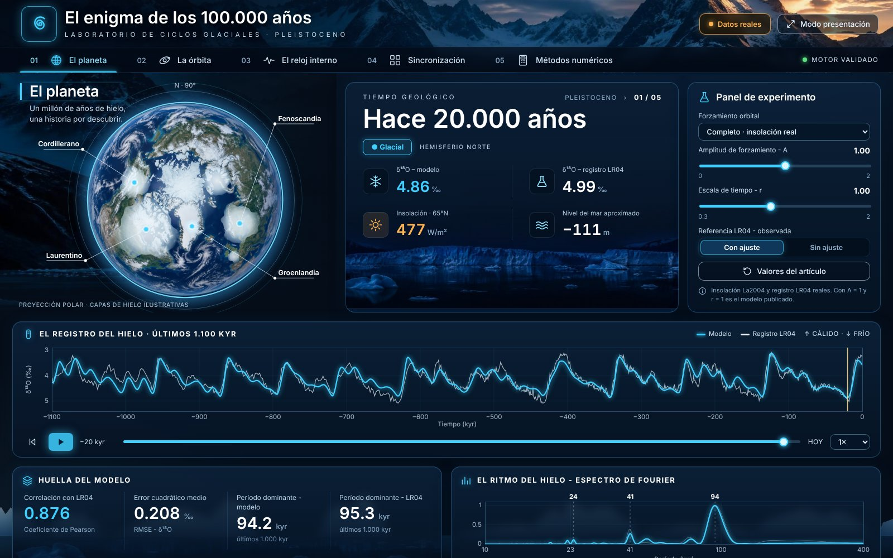
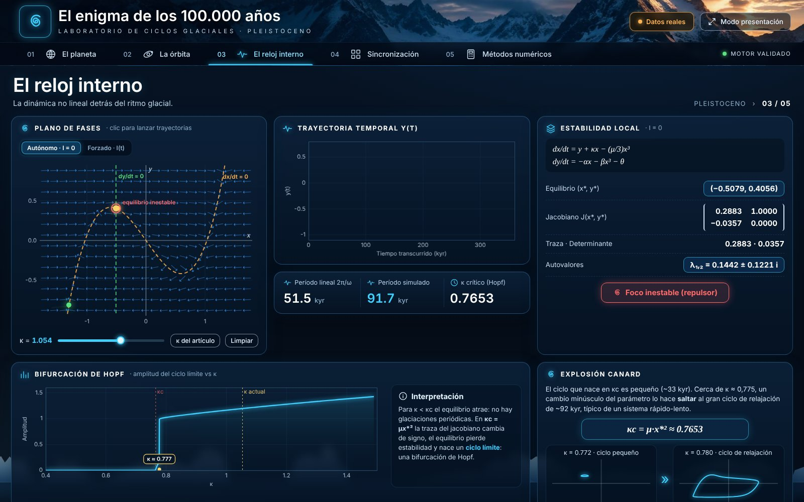
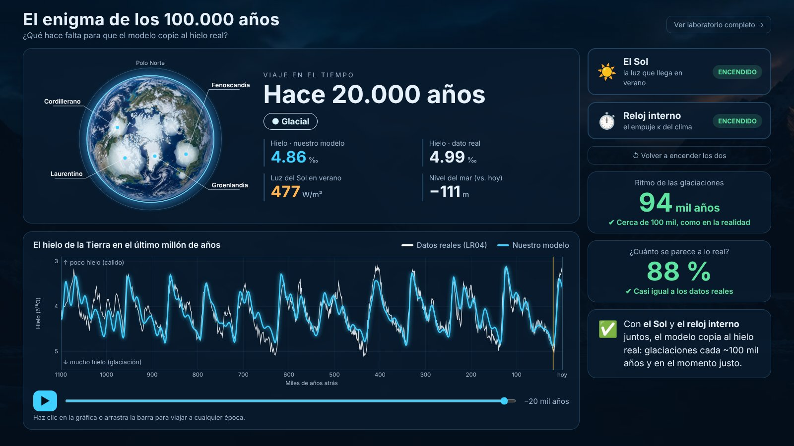

# El enigma de los 100.000 años

**Simulador interactivo de los ciclos glaciales del Pleistoceno como sistema dinámico no lineal.**
Proyecto final de Ecuaciones Diferenciales · UAGRM, FICCT · 2026.

🔗 **Demo en vivo:** https://elmertoledo.github.io/enigma-100k/
🔗 **Versión simple (para exponer):** https://elmertoledo.github.io/enigma-100k/simple.html



## La pregunta

La luz del Sol que llega en verano al hemisferio norte cambia en ciclos de **23 y 41 mil años** (ciclos de Milankovitch). Sin embargo, durante el último millón de años las glaciaciones se repitieron cada **~100 mil años**. ¿De dónde sale ese ritmo?

## La respuesta del modelo

El clima tiene un **reloj interno**: un oscilador no lineal que oscila solo con un período de ~92 mil años. La luz del Sol **no crea** el ciclo, solo lo **pone en hora** (sincronización).

## El modelo

Es el modelo SO (*Self-sustained Oscillator*) de Mitsui, Ditlevsen, Boers y Crucifix (2025), un sistema de dos EDO de primer orden, no lineales, acopladas y forzadas (oscilador de Van der Pol forzado):

$$
r\,\frac{dx}{dt}=y+\kappa x-\frac{\mu}{3}x^{3}
$$

$$
r\,\frac{dy}{dt}=-\alpha x-\beta x^{3}-\theta-(\nu+\rho x)\,A\,I(t)-\eta\,\big[A\,I(t)\big]^{2}
$$

$$
I(t)=\frac{Q_{65^\circ N}(t)-495{,}7}{24}\qquad\qquad \delta^{18}\mathrm{O}=y+4+\delta
$$

| Símbolo | Significado |
|---|---|
| $x$ | Variable climática interna (rápida) |
| $y$ | Volumen de hielo (lento) |
| $I(t)$ | Insolación de verano a 65° N, normalizada (media 495,7 W/m², desviación 24 W/m²) |
| $\kappa,\ \mu$ | Autorrefuerzo y freno cúbico del clima |
| $\alpha,\ \beta,\ \theta$ | Acoplamiento clima → hielo y asimetría del ciclo |
| $\nu,\ \rho,\ \eta$ | Efecto de la insolación sobre el hielo |
| $r,\ A$ | Escala de tiempo y amplitud del forzamiento (ambas = 1 en el artículo) |

Se usan los 9 parámetros publicados. Con $r = 1$ y $A = 1$ es exactamente el modelo del artículo.

## Las dos versiones

### Laboratorio completo (`index.html`)

| # | Pantalla | Qué muestra |
|---|----------|-------------|
| 1 | El planeta | Hielo del hemisferio norte animado con δ¹⁸O simulado, comparación con LR04, espectro de Fourier y métricas. Permite cambiar el forzamiento, `A` y `r`. |
| 2 | La órbita | Excentricidad, oblicuidad y precesión (La2004), insolación a 65° N y su espectro: la paradoja de los 100 kyr. |
| 3 | El reloj interno | Plano de fases, nulclinas, equilibrio, jacobiano, autovalores, bifurcación de Hopf y explosión canard. Clic en el plano para lanzar trayectorias. |
| 4 | Sincronización | Mapa de 1.449 simulaciones (r × A) y la Transición del Pleistoceno Medio (de 41 a 100 kyr). |
| 5 | Métodos numéricos | Euler, Heun y RK4: convergencia log-log, orden observado y estabilidad. |

Atajos: ← → cambian de pantalla, barra espaciadora reproduce, **F** activa el modo presentación.



### Versión simple (`simple.html`)

Una sola pantalla con dos interruptores, **el Sol** y **el reloj interno**, para mostrar que hacen falta los dos:

| Sol | Reloj interno | Ritmo | Correlación con LR04 |
|---|---|---|---|
| ✅ | ✅ | 94 kyr | 0,88 |
| ❌ | ✅ | 92 kyr | −0,26 (a destiempo) |
| ✅ | ❌ | 41 kyr | 0,52 (solo copia al Sol) |
| ❌ | ❌ | — | el clima se queda quieto |



## Validación

| Prueba | Resultado | Referencia |
|---|---|---|
| Período sin forzamiento ($I = 0$) | 91,7 kyr | artículo: 91,7 kyr |
| Equilibrio $(x^*, y^*)$ | (−0,50794; 0,40561) | cálculo analítico |
| Autovalores en el equilibrio | $0{,}14417 \pm 0{,}12206\,i$ (foco inestable) | cálculo analítico |
| $\kappa$ crítico de Hopf $= \mu\,x^{*2}$ | 0,76529 | cálculo analítico |
| Correlación con LR04 (1000–0 ka) | 0,879 | código de los autores: 0,8790002 |
| Período dominante modelo / LR04 | 94,2 / 95,3 kyr | — |
| Orden observado (ventana de 50 kyr) | Euler 0,97 · Heun 1,93 · RK4 4,17 | teórico: 1, 2, 4 |

## Cómo usarlo

- **En línea:** abre la demo del enlace de arriba.
- **Sin internet:** descarga el repositorio y haz doble clic en `index.html` o `simple.html`. Funciona en Chrome o Edge sin instalar nada.

## Estructura

```
├── index.html          laboratorio completo (5 pantallas)
├── simple.html         versión simple para exponer
├── estilos.css
├── assets/             imágenes de la interfaz
├── capturas/           capturas para este README
├── js/
│   ├── datos.js        órbita La2004 (2,1 Ma) + LR04
│   ├── modelo.js       EDO, insolación, Euler, Heun, RK4
│   ├── analisis.js     equilibrio, jacobiano, autovalores, Hopf, FFT, métricas
│   ├── graficos.js     gráficas en canvas
│   ├── escenario.js    fondos decorativos
│   └── app.js          lógica de las pantallas
└── datos/              registros originales (LR04 e insolación)
```

## Créditos y fuentes

Este repositorio es una **implementación propia** del modelo con fines educativos. El modelo y los datos pertenecen a sus autores:

- **Modelo y parámetros:** T. Mitsui, P. Ditlevsen, N. Boers y M. Crucifix (2025), *Earth System Dynamics* 16, 1569–1584, doi:[10.5194/esd-16-1569-2025](https://doi.org/10.5194/esd-16-1569-2025). Código de los autores (MIT): [takahito321/Codes-for-ESD-paper-on-100-kyr-ice-age-cycles](https://github.com/takahito321/Codes-for-ESD-paper-on-100-kyr-ice-age-cycles).
- **Órbita:** solución La2004 (Laskar et al., 2004, *A&A* 428, 261), vía el paquete R `palinsol` (M. Crucifix). Insolación con la fórmula de Berger (1978), S0 = 1368 W/m², solsticio de junio, 65° N.
- **δ¹⁸O:** stack LR04 de Lisiecki y Raymo (2005), *Paleoceanography* 20, PA1003.

## Advertencias

- $x$ e $y$ son variables conceptuales: no son temperatura ni volumen de hielo medidos directamente.
- El dibujo del hielo en el globo es ilustrativo: su tamaño sale de δ¹⁸O, pero la forma es aproximada.
- LR04 usa una cronología ajustada en parte con la órbita, así que coincidir con ella no es una validación totalmente independiente.

## Autor

**Elmer Lino Toledo** · Ingeniería Informática, UAGRM (FICCT) · Grupo 13, Ecuaciones Diferenciales.

Código bajo licencia MIT (ver `LICENSE`).
